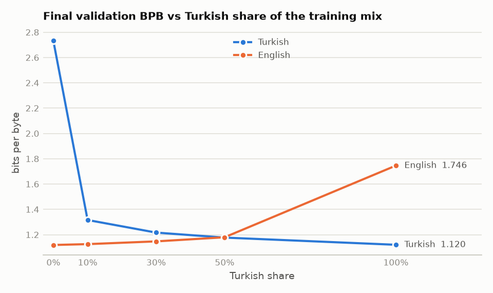
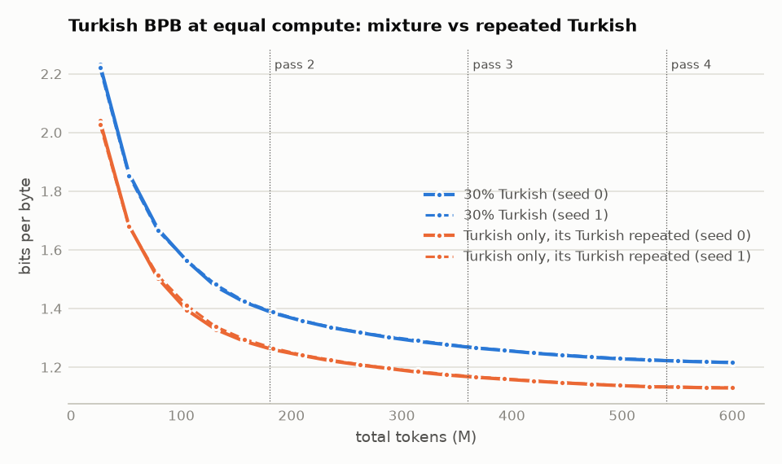
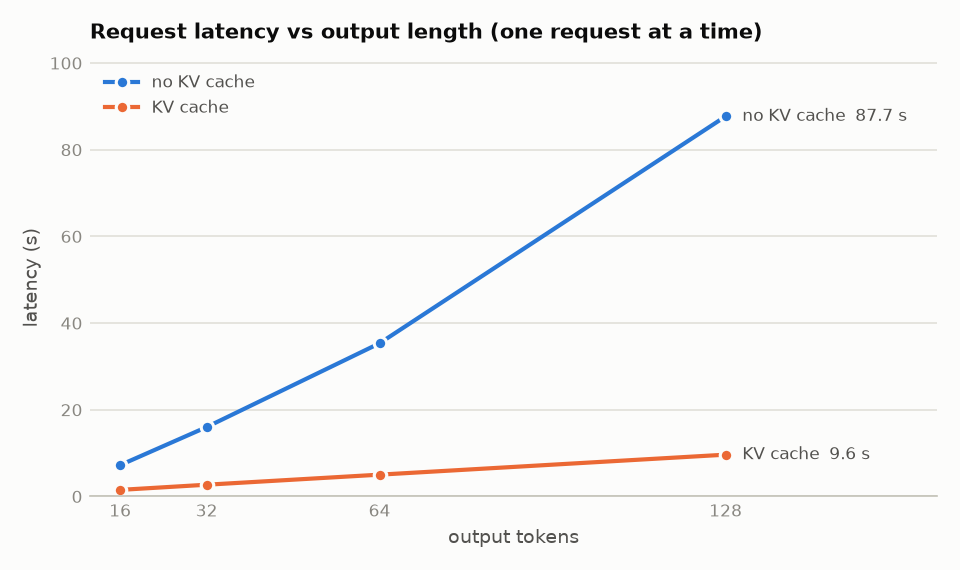
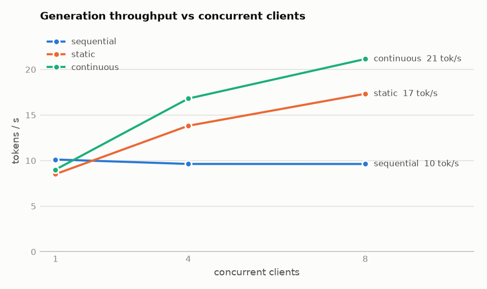

# bilingual-slm

[](https://github.com/DeerKaraca/bilingual-slm/actions/workflows/tests.yml)
[](LICENSE)
[](https://huggingface.co/DeerKaraca/bilingual-slm-42m-tr050)

Turkish–English language models trained from scratch, a controlled study of how the language mix
affects them, and an inference server written from scratch, without serving libraries (no vLLM / TGI).

- **Research:** nine 42.5M-parameter models trained on Kaggle T4 GPUs to measure how the Turkish/English
  ratio affects each language ([full report](reports/research/README.md)).
- **Model:** the 50/50 model is public on the Hugging Face Hub:
  [DeerKaraca/bilingual-slm-42m-tr050](https://huggingface.co/DeerKaraca/bilingual-slm-42m-tr050).
- **Server:** KV cache, continuous batching, SSE streaming, int8 quantization and an OpenAI-compatible API,
  packaged with Docker and load-tested.

## Research result

**In this 42.5M-parameter setting, at equal compute, repeating the same 180M Turkish tokens ~3.3 times beats
adding 420M English tokens by 0.087 Turkish bits per byte (72× the seed noise), and comes within 0.010 BPB of
fresh Turkish data.** English does help Turkish compared with a shorter-trained model, but it is less than half
as valuable as repeating Turkish itself; whether that gain is transferred knowledge or extra training cannot be
told apart here.

| Run (42.5M parameters, 600M tokens unless noted) | Turkish data | Turkish BPB |
|---|---|---|
| Turkish-only control, 180M tokens (686 steps) | 180M, once | 1.278 |
| 30% Turkish + 70% English (2 seeds) | 180M, once, + 420M English | 1.216 |
| **Turkish-only, compute-matched (2 seeds)** | **the same 180M, ~3.3 times** | **1.130** |
| Turkish-only | 600M distinct | 1.120 |

<p> </p>

- **Mixing ratio:** 10% Turkish already brings most of the Turkish gain (2.73 → 1.32 BPB) at a 0.6% English cost.
- **Robustness:** the result holds on validation subsets without any text overlapping the repeated training data
  (gap 0.080 BPB on the strictest one), and the repeated runs show no overfitting.
- **Method:** decision rules were committed before the runs ([plan](reports/analysis_plan.md),
  [addendum](reports/analysis_plan_addendum.md)); key runs have two seeds.
- **Context:** larger models may transfer more between languages; see the
  [limitations](reports/research/README.md#limitations).

## Model

```python
from transformers import AutoModelForCausalLM, AutoTokenizer

tokenizer = AutoTokenizer.from_pretrained("DeerKaraca/bilingual-slm-42m-tr050")
model = AutoModelForCausalLM.from_pretrained("DeerKaraca/bilingual-slm-42m-tr050")
```

A base model, not instruction-tuned. One shared tokenizer for both languages: 1.77 tokens per Turkish word,
against GPT-2's 3.78.

## Inference server

```bash
python -m slm.server --model DeerKaraca/bilingual-slm-42m-tr050
curl localhost:8000/v1/completions -H "Content-Type: application/json" \
  -d '{"prompt": "Bilim insanları yeni bir araştırmada", "max_tokens": 40, "stream": true}'
docker compose up --build
```

- **Engine:** one thread owns the model and a preallocated KV cache; each step decodes one token for every
  active request. Modes: `no_cache`, `sequential`, `static`, `continuous` (default).
- **API:** `/v1/completions`, `/v1/chat/completions`, `/v1/models`, `/health`, with SSE streaming.
- **Correctness:** logits match `transformers` to within 1e-4, and batched decoding gives exactly the same tokens as a
  simple reference loop.

### Serving benchmark (CPU, SmolLM2-135M-Instruct)

Ryzen 5 3500U, 3 threads. Setup and full tables: [reports/serving.md](reports/serving.md).

<p> </p>

| 8 concurrent clients, 16 mixed requests | Throughput | Time to first token (p50) | Latency p50 / p95 |
|---|---|---|---|
| sequential (one request at a time) | 9.8 tok/s | 33.2 s | 38.9 s / 70.7 s |
| static batching | 15.3 tok/s | 7.0 s | 20.7 s / 33.1 s |
| **continuous batching** | **21.5 tok/s** | **2.2 s** | **15.5 s** / 45.8 s |

- **KV cache:** 4.8x faster at 16 output tokens and 9.1x at 128.
- **Continuous batching:** 2.2x the throughput of sequential serving and the first token 15x sooner. The cost
  is a heavier p95 tail, because long requests keep sharing steps with new ones.
- **Found by benchmarking:** gathering KV-cache rows with an index list took 43% of a decode step; reading the
  cache as one slice halved the CPU time of a batch-8 step.
- **Noise:** likely laptop CPU throttling caused up to ~25% variation within a long benchmark, so small differences
  are not meaningful.
- **Docker:** peaks at 1.56 GiB under load, within a 2 GiB memory limit.

### Quantization (CPU)

| Variant | SmolLM2-135M: weights / EN BPB / top-1 agreement | tr050 (42.5M): weights / TR BPB / top-1 agreement |
|---|---|---|
| float32 | 513 MB / 0.9144 / 100% | 162 MB / 1.1629 / 100% |
| int8 weight-only (ours) | 210 MB / 0.9161 / 96.8% | 89 MB / 1.1629 / 99.0% |
| int8 + int8 embedding (ours) | **129 MB** / 0.9165 / 96.1% | **41 MB** / 1.1629 / 98.7% |
| torch `quantize_dynamic` (reference) | 210 MB / 1.2270 / 50.1% | 89 MB / 1.1965 / 78.8% |

BPB here is measured on the first 16,384 tokens of each language's validation set in 512-token windows, the
same text for every variant, so it is not comparable with the research results (tr050: 1.177 on the full set).

Our weight-only int8 is almost lossless and makes the model up to 4x smaller (with the embedding table in int8
too), but it is slower on this CPU: decoding
is limited by memory bandwidth, and without a fused kernel each int8 weight is converted to float on every
step. `quantize_dynamic` also quantizes activations, so activation outliers break it, the problem addressed by
[LLM.int8()](https://arxiv.org/abs/2208.07339) and [SmoothQuant](https://arxiv.org/abs/2211.10438).
Details: [quantization report](reports/quantization.md).

## Reproduce

Kaggle notebooks for each stage are in `notebooks/`. The analysis runs offline from the committed logs:

```bash
uv venv
uv pip install torch --index-url https://download.pytorch.org/whl/cpu
uv pip install -e ".[dev,data,server]"
.venv/bin/python -m pytest
.venv/bin/python -m slm.eval.analysis
```

## Limitations

- One model size (42.5M) and one budget (600M tokens); full list in the
  [report](reports/research/README.md#limitations).
- Server: prefill runs one request at a time, so a long prompt delays the others; the KV cache is slot-based,
  not paged.

## AI-assisted development

This project was developed with the assistance of modern AI tools:

- Code Optimization & Refactoring: Leveraged AI for improving code efficiency, debugging, and code readability.
- Documentation: Drafted and refined project documentation and summaries with AI support.
- Architecture & Design: All core business logic, system architecture, and final testings were fully implemented and verified by me.

## License and data

Code and model weights: [Apache License 2.0](LICENSE). Trained on
[FineWeb2-HQ](https://huggingface.co/datasets/epfml/FineWeb2-HQ) and
[FineWeb-Edu](https://huggingface.co/datasets/HuggingFaceFW/fineweb-edu), both under the
[ODC-By 1.0](https://opendatacommons.org/licenses/by/1-0/) license and subject to
[Common Crawl's Terms of Use](https://commoncrawl.org/terms-of-use).
