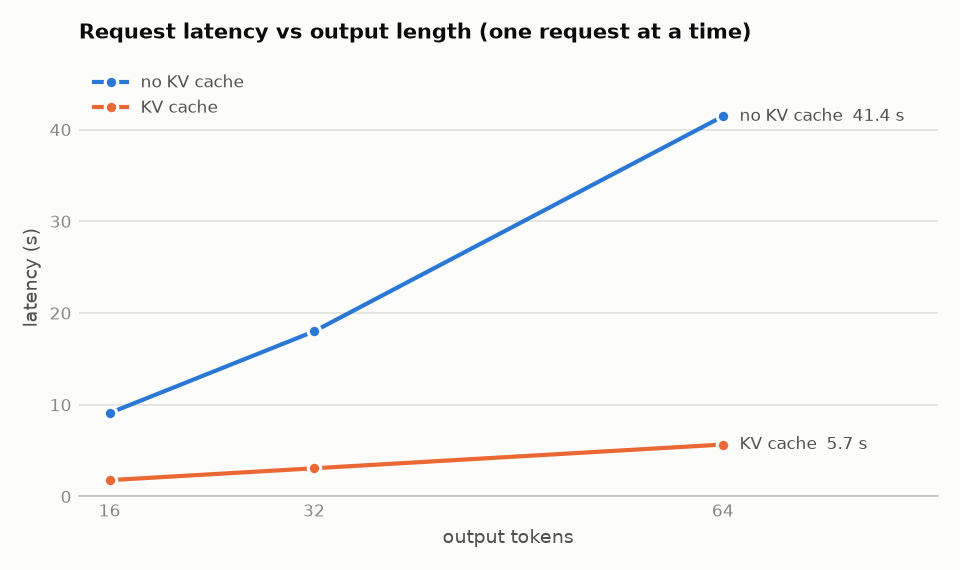
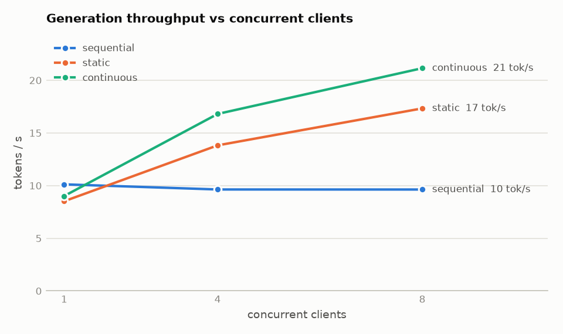

# bilingual-slm

A ~40M-parameter Turkish–English language model trained from scratch, and a hand-written
inference server for it (no vLLM / TGI).

**Research question:** how does the Turkish/English ratio in the pre-training mix affect
performance in each language? How much does English transfer to Turkish, and when does one
language start to hurt the other?

> 🚧 Work in progress. Results and benchmark numbers will be filled in as the stages complete.

## Plan

| Part | What |
|---|---|
| Data | FineWeb-2 (Turkish) + FineWeb-Edu (English), streamed, cleaned, tokenized into shards |
| Tokenizer | One shared 32k byte-level BPE for all runs; fertility reported per language |
| Model | Decoder-only transformer: RoPE, RMSNorm, SwiGLU, fp16 mixed precision |
| Experiments | 0 / 10 / 30 / 50 / 100 % Turkish at 600M tokens each, plus a Turkish-only control matched to the Turkish tokens of the 30 % run |
| Metric | Per-language validation **bits-per-byte** (comparable across languages, unlike perplexity) |
| Server | KV cache, continuous batching, SSE streaming, int8 weight-only quantization, OpenAI-compatible API, Docker, load tests |

## Repository layout

```
slm/            Python package (config, data, tokenizer, model, train, eval, server)
configs/        YAML configs; experiments/ holds one file per run
notebooks/      Kaggle notebooks (clone repo -> train with resume)
benchmarks/     Load tests and server benchmarks
reports/        Generated plots and research report
tests/          Unit tests (run on CPU)
```

## Development

Developed on Linux (WSL2) with Python 3.13, matching Kaggle.

```bash
uv venv
uv pip install torch --index-url https://download.pytorch.org/whl/cpu
uv pip install -e ".[dev,data,server]"
.venv/bin/python -m pytest
```

## Pipeline

| Step | Where | Command / notebook |
|---|---|---|
| 1. Stream + clean text | Kaggle CPU | `notebooks/01_prepare_data.ipynb` (`python -m slm.data.prepare`) |
| 2. Tokenizer, fertility, token shards | Kaggle CPU | `notebooks/02_tokenize.ipynb` (`slm.tokenizer`, `slm.eval.fertility`, `slm.data.tokenize`) |
| 3. Train (two runs per session, auto-resume) | Kaggle T4 x2 | `notebooks/03_train.ipynb` (`python -m slm.train --config configs/experiments/<run>.yaml`) |

## Inference server

Written from scratch on PyTorch + FastAPI (no vLLM / TGI). It serves our checkpoints and any
Llama-architecture HF model; development uses [SmolLM2-135M](https://huggingface.co/HuggingFaceTB/SmolLM2-135M-Instruct),
whose layout (RMSNorm, RoPE, SwiGLU, tied embeddings) matches ours plus grouped-query attention.

```bash
python -m slm.server --model HuggingFaceTB/SmolLM2-135M-Instruct   # or: --model runs/tr030/final.pt --tokenizer assets/tokenizer.json
curl localhost:8000/v1/chat/completions -H "Content-Type: application/json"   -d '{"messages": [{"role": "user", "content": "What is the capital of France?"}], "stream": true}'
```

- **Engine:** one thread owns the model and a preallocated slot-based KV cache; every step decodes one token for all
  active requests, each at its own position. Attention is cut at the longest active sequence, not at the cache size.
- **Modes** (`--mode`): `no_cache`, `sequential`, `static` batching, `continuous` batching (default).
- **API:** `/v1/completions`, `/v1/chat/completions` (ChatML via the model's own chat template; models without
  instruction tuning get a clear 400), `/v1/models`, `/health`. SSE streaming, `temperature`, `top_p`, `top_k`,
  `stop`, `seed`. Disconnected clients free their slot immediately.
- **Correctness:** `benchmarks/parity.py` loads SmolLM2-135M into our model and compares with `transformers`:
  max logit difference 5e-5, identical greedy output.

### Serving benchmark (CPU, SmolLM2-135M-Instruct)

`benchmarks/loadtest.py` is an async client (httpx + SSE) that starts the server in each mode and measures
time to first token, inter-token latency and throughput. Server pinned to 3 torch threads on a 4-core Ryzen 5 3500U,
leaving one core for the client; greedy decoding with `ignore_eos` so every request generates exactly its
`max_tokens`; medians over 4 rounds with the mode order rotated each round. Full tables:
[reports/serving.md](reports/serving.md).

<p> </p>

| 8 concurrent clients, 16 mixed requests | Throughput | Time to first token (p50) | Latency p50 / p95 |
|---|---|---|---|
| sequential (one request at a time) | 9.6 tok/s | 36.9 s | 41.2 s / 53.1 s |
| static batching | 17.3 tok/s | 6.1 s | 20.0 s / 28.1 s |
| **continuous batching** | **21.1 tok/s** | **2.1 s** | **13.9 s** / 37.4 s |

- **KV cache:** 5.1x faster at 16 output tokens, 7.3x at 64; without it every token recomputes the whole sequence.
- **Continuous batching** gives 2.2x the throughput of sequential serving and the first token 18x sooner. Against
  static batching the main gain is waiting time: new requests take a free slot at the next step instead of waiting
  for the whole batch. The price is a heavier tail (p95), because the batch never drains and long requests keep
  sharing steps with newcomers.
- **Two things the benchmark caught:** (1) the decode step spent 43% of its time gathering KV-cache rows with an
  index list (a copy per layer per step); the engine now keeps active requests in slots `0..n-1` and reads the
  cache as a slice, which halved the CPU time of a batch-8 step. (2) With a fixed mode order the mode that always
  ran last looked ~18% slower at concurrency 1, where the code paths are identical: the laptop CPU throttles as it
  heats up. Rotating the order removed the gap.
- **Docker:** `docker compose up --build` (CPU image, 1.5 GB, mostly PyTorch). Weights are downloaded on first
  start into a cache volume. Peak memory under load 1.76 GB, of which ~755 MB is the preallocated KV cache
  (8 slots x 2048 tokens); `MAX_LEN=1024` halves it.

### Quantization (CPU, SmolLM2-135M)

`python -m slm.server --quant int8-emb` serves with our weight-only int8; full numbers in
[reports/quantization.md](reports/quantization.md) (`benchmarks/quantization.py`), diagnosis in
[reports/dynamic_quant_analysis.md](reports/dynamic_quant_analysis.md).

| Variant | Weights | Decode tok/s (B=1 / B=8) | EN BPB | TR BPB | Top-1 agreement with fp32 (EN / TR) |
|---|---|---|---|---|---|
| float32 | 513 MB | 11.5 / 49.6 | 0.9144 | 2.1533 | 100% / 100% |
| int8 weight-only (ours) | 210 MB | 6.7 / 36.1 | 0.9161 | 2.1564 | 96.8% / 95.2% |
| int8 weight-only + int8 embedding (ours) | **129 MB** | 6.3 / 33.5 | 0.9165 | 2.1565 | 96.1% / 94.8% |
| torch `quantize_dynamic` (reference) | 210 MB | 19.1 / 81.9 | 1.2270 | 3.1793 | 50.1% / 36.0% |
| `quantize_dynamic` + lm_head | 237 MB | 23.3 / 118.3 | 1.2595 | 3.2557 | 47.6% / 34.1% |

- **Weight-only int8 is almost lossless** (+0.002 BPB) and cuts weights 4x once the tied embedding table is int8 too.
  Quantizing the embedding saves another 81 MB (39%) for +0.0004 BPB.
- **It is slower on this CPU, not faster.** Decoding is memory-bound (~10 GB/s on a Ryzen 5 3500U, so reading 513 MB
  of fp32 weights alone caps B=1 at ~19 tok/s). Without a fused kernel, eager PyTorch must cast int8 to a float
  copy on every call, which costs more bandwidth than it saves. PyTorch's fused `_weight_int8pack_mm` was only 7%
  faster than fp32 at B=1 and 4-14x slower at B>=8 on this machine, so it is not used.
- **`quantize_dynamic` is fast but breaks the model.** It also quantizes activations, with one scale per matrix.
  Inputs to `mlp.down` have outliers up to 40,000x the median magnitude, so most values round to zero; keeping only
  `mlp.down` in float recovers most of the quality (EN BPB 1.23 -> 1.02). The scale is shared across the batch, so
  output quality even depends on which requests are batched together (BPB 1.21 at batch 1 vs 1.27 at batch 4).
  This is the known activation-outlier problem of LLM quantization: [LLM.int8()](https://arxiv.org/abs/2208.07339)
  (Dettmers et al., 2022) keeps the few outlier feature dimensions in 16-bit and the rest in int8, and
  [SmoothQuant](https://arxiv.org/abs/2211.10438) (Xiao et al., 2023) rescales channels to move the outliers from
  activations into the weights, which tolerate quantization better. Weight-only int8 sidesteps it by not touching
  activations at all.
- Quantizing `lm_head` with `quantize_dynamic` *grows* the weights: it gets its own int8 copy and the tie with
  the fp32 embedding is lost. Our `Int8Embedding` shares the int8 table instead.

## Known limitations

- **Quality filters differ between languages.** English comes from FineWeb-Edu (an educational-value
  classifier), Turkish from FineWeb2-HQ (an embedding-based quality classifier). Both are
  "high-quality" subsets, but not filtered identically, so part of any cross-lingual effect may come
  from differences in data quality rather than language alone.
- **Server:** prefill runs one request at a time, so a long prompt stalls decoding for the others (chunked prefill
  would fix this); the KV cache is slot-based, not paged.
- `torch.ao.quantization` (used only as the `quantize_dynamic` reference) is deprecated in favour of torchao.
