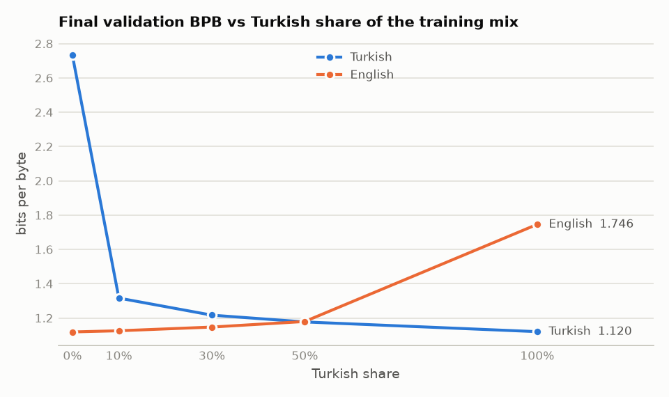
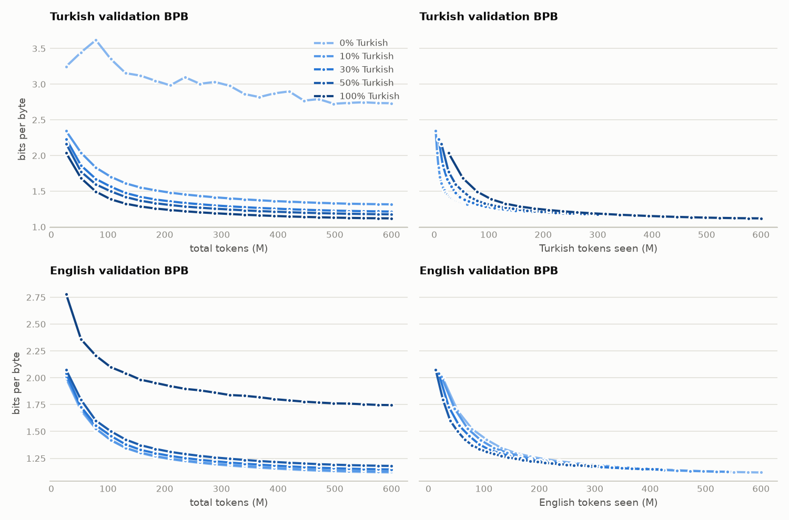
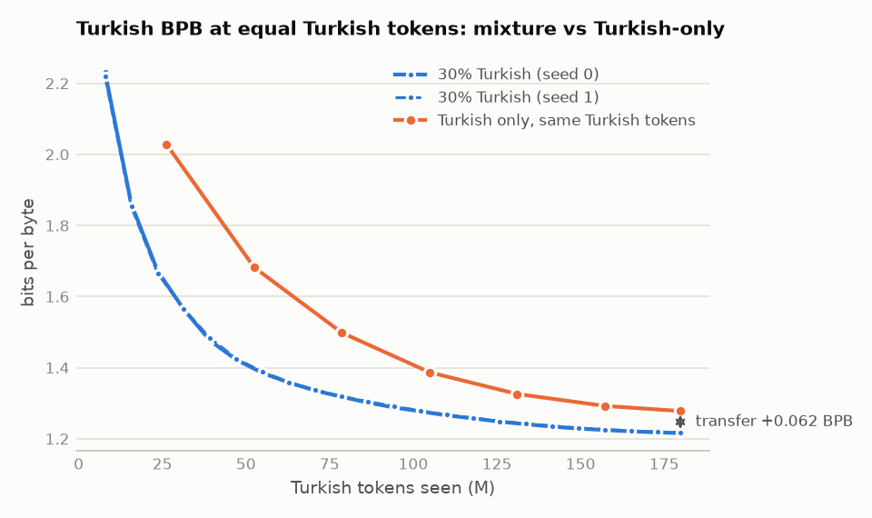
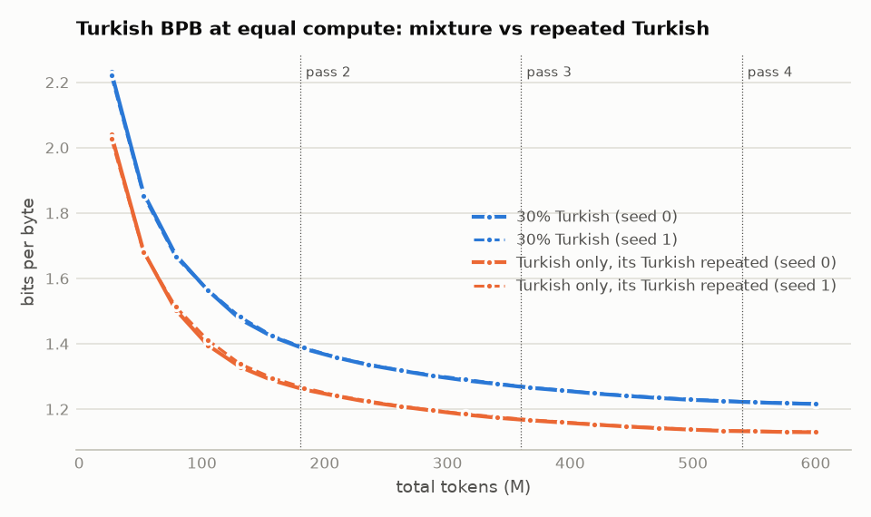

# How does the Turkish/English mix affect a small language model?

**Main result.** At equal compute, repeating the same 180M Turkish tokens ~3.3 times beats adding
420M English tokens by 0.087 Turkish bits per byte (72× the seed noise), and comes within 0.010 BPB of
fresh Turkish data. The pre-registered positive-transfer result (+0.062 vs. a shorter-trained control)
holds, but English is less than half as valuable for Turkish as repeating Turkish itself; this setup
cannot tell how much of English's gain is transferred knowledge versus extra training.

All numbers come from [results.md](results.md) / [results.json](results.json), produced by
`python -m slm.eval.analysis`, unless a section says otherwise.

## Setup

- **Model:** 42.5M-parameter decoder-only transformer (8 layers, width 512, RoPE, RMSNorm, SwiGLU,
  tied embeddings, context 1,024), the same for every run.
- **Data:** Turkish from FineWeb2-HQ (`tur_Latn`), English from FineWeb-Edu (`sample-10BT`); light
  cleaning, exact deduplication. Every sequence is one language and the mixture ratio is exact.
  Without repetition each window is read at most once, and runs with the same seed read the same
  windows in the same order.
- **Tokenizer:** one 32k byte-level BPE trained on equal amounts of both languages, shared by all runs.
- **Training:** 600M tokens (2,288 steps of 262k tokens), AdamW, warmup + cosine schedule over each
  run's own length, fp16 on Kaggle T4 GPUs. Code pinned to tags `train-v1` (all runs below except
  x3) and `train-v2` (x3; adds only the repetition cap, batch-identical otherwise, tested).
- **Metric:** validation bits per byte on 10.5 MB of held-out Turkish and English text each, comparable
  across languages and tokenizers.

| Run | Turkish share | Turkish tokens | English tokens | Steps |
|---|---|---|---|---|
| tr000, tr010, tr030, tr050, tr100 | 0 / 10 / 30 / 50 / 100% | 0-600M | 600M-0 | 2,288 |
| tr030_seed1 | 30% (seed 1) | 180M | 420M | 2,288 |
| tr_only_control | 100% | 180M (tr030's) | 0 | 686 |
| tr_only_control_x3 (+ seed 1) | 100% | 180M (tr030's) repeated ~3.3× | 0 | 2,288 |

Steps are whole numbers, so token budgets are rounded down to full steps: tr030 reads 175,718 Turkish
windows (30% of 2,288 × 256 sequences) and the control 175,616 (686 × 256 for its 180M tokens), i.e. the
control sees 102 windows (~0.06%) fewer; the windows it does see are the first 175,616 of tr030's.

## Pre-registered results

Metrics, comparisons and decision rules were fixed in [analysis_plan.md](../analysis_plan.md) before
any run finished. A difference counts only beyond twice the seed-to-seed range of tr030.

**Seed noise:** |tr030 − tr030_seed1| = 0.0012 Turkish BPB, 0.0007 English BPB.

### Q1. Effect of the Turkish share

| Turkish share | 0% | 10% | 30% | 50% | 100% |
|---|---|---|---|---|---|
| Turkish BPB | 2.733 | 1.316 | 1.216 | 1.177 | **1.120** |
| English BPB | **1.118** | 1.125 | 1.147 | 1.179 | 1.746 |
| Turkish BPB above Turkish-only | | +17.5% | +8.6% | +5.1% | |
| English BPB above English-only | | +0.6% | +2.5% | +5.4% | |



Returns are steep and then flatten: 10% Turkish already takes Turkish from 2.73 to 1.32 BPB for a 0.6%
English cost; at 50% both languages are about 5% behind their monolingual models.



### Q2. Transfer from English (primary)

`control − tr030` = **+0.0616 Turkish BPB** (4.8% of the control), 51× the noise → under the rule:
**English helps Turkish (positive transfer)**. The control saw the same 180M Turkish tokens but only
686 steps; see the compute-matched control below for what this comparison can and cannot show.



### Q3. Interference (indicative)

Final BPB of each mixture against the monolingual model's curve at the same tokens of that language.
Curve points before the end of a run have not had their learning rate decayed, so this comparison is
biased in the mixtures' favour and was declared indicative only.

| Run | Language | Tokens of it seen | Final BPB | Monolingual curve | Gap | Reading |
|---|---|---|---|---|---|---|
| tr010 | TR | 60M | 1.3159 | 1.6290 | −0.3131 | below the curve |
| tr030 | TR | 180M | 1.2158 | 1.2618 | −0.0460 | below the curve |
| tr050 | TR | 300M | 1.1768 | 1.1871 | −0.0103 | below the curve |
| tr010 | EN | 540M | 1.1252 | 1.1237 | +0.0015 | interference likely |
| tr030 | EN | 420M | 1.1465 | 1.1467 | −0.0002 | inconclusive |
| tr050 | EN | 300M | 1.1793 | 1.1886 | −0.0093 | below the curve |

The one "interference likely" reading (tr010, English) is +0.0015 against a threshold of 0.0014: a
weak, borderline signal. There is no English control at matched English tokens, so for English the
effect of seeing fewer English tokens cannot be separated from interference by Turkish.

## Compute-matched control (addendum)

[analysis_plan_addendum.md](../analysis_plan_addendum.md) was written **after** the results above
and **before** these runs. tr030 took 2,288 steps and the control 686, so Q2 could reflect more
training rather than English. The x3 control gets tr030's exact Turkish windows, repeated to tr030's
600M tokens and 2,288 steps; two seeds.

| | Turkish BPB (seed means) |
|---|---|
| tr030: 180M Turkish + 420M English | 1.2164 |
| x3 control: the same 180M Turkish, ~3.3 passes | **1.1298** |
| x3 − tr030 | **−0.0867** (noise 0.0012; x3 seed range 0.0009) |

Under the pre-written rule: **at equal compute, repeating Turkish beats adding English.**



- **No overfitting to the repeated data:** both x3 runs reach their lowest Turkish BPB at the last
  evaluation, in pass 4; the curve keeps falling across pass boundaries (rise 0.0000).
- **Repetition is almost as good as fresh data:** x3 is 0.0097 BPB behind tr100, which saw 600M distinct
  Turkish tokens. This agrees with Muennighoff et al. (2023), who found up to ~4 epochs of repeated
  data to be nearly as useful as new data; ~3.3 passes is below that, which also makes x3 a strong
  control.
- **Putting the controls together:** relative to the 686-step control, adding 420M English tokens gains
  0.0616 BPB and repeating the Turkish gains 0.1482, so per unit of compute English is worth 42% of
  repeated Turkish for Turkish. How much of English's gain is transferred knowledge and how much is
  simply more optimizer steps, this design cannot separate.

## Exploratory analyses (not pre-registered)

### Schedule handicap of the control

tr100 and tr_only_control read exactly the same Turkish windows in the same order for the first 686
steps; only the learning-rate schedule differs. At that point (interpolated between tr100's evaluations
at steps 600 and 700) tr100, whose learning rate is still high, has 1.2618 Turkish BPB; the control,
fully decayed and with 29% of its steps in warmup, ends at 1.2780. The short
schedule costs the control ~0.016 BPB, so a conservative Q2 estimate is 1.2618 − 1.2158 = 0.046 BPB,
still ~38× the noise.

### Validation/train overlap

Exact duplicate documents are excluded between validation and training by construction. Measured
before the x3 runs (`python -m slm.eval.overlap`): 3.27% (seed 0) and 3.19% (seed 1) of Turkish
validation 13-grams also occur in the 175,718 repeated training windows.

**x3 still beats tr030 on every overlap-free subset:** the gap shrinks from 0.087 to 0.080 Turkish BPB
when every validation document with any overlapping 13-gram is removed, still ~66× the seed noise. This
tests the main objection to the compute-matched result, that x3 wins because it memorised validation
text it saw ~3.3 times. Full numbers: [clean_val.md](clean_val.md) (`benchmarks/clean_val_eval.py`).

Each validation document gets the share of its 13-grams found in the repeated training windows of either
seed; the subsets drop documents above a threshold. The 20% threshold was chosen after seeing the
distribution below, so 50% is shown too. The subsets are clean for every model: tr030 and tr030_seed1
read exactly the x3 pools of their seeds and the control the first 175,616 windows of the seed-0 pool
(English windows of the tr030 runs are not scanned).

| Share of the document's 13-grams in the training windows | Documents | Validation tokens | Mean document length |
|---|---|---|---|
| none | 2,526 | 49.3% | 434 |
| 0-1% | 297 | 18.4% | 1,375 |
| 1-5% | 349 | 13.5% | 861 |
| 5-20% | 271 | 11.4% | 934 |
| 20-50% | 178 | 5.4% | 673 |
| 50-100% | 88 | 2.0% | 499 |

Most overlap is incidental (a shared phrase in a long document); the 266 documents above 20% look like
near-duplicates of training text that escaped the sources' deduplication. Because a single shared
13-gram is enough to drop a document, the "any overlap" subset removes long documents disproportionately
and shifts the validation distribution towards short ones.

| Turkish BPB | full validation | without docs >50% overlapping | without docs >20% overlapping | without any overlapping doc |
|---|---|---|---|---|
| tokens kept | 100% | 98% | 93% | 49% |
| tr030 (seed mean) | 1.2164 | 1.2173 | 1.2186 | 1.2202 |
| x3 control (seed mean) | 1.1298 | 1.1316 | 1.1341 | 1.1406 |
| tr_only_control | 1.2780 | 1.2789 | 1.2798 | 1.2793 |
| **x3 − tr030** | **−0.0866** | **−0.0857** | **−0.0845** | **−0.0795** |

As overlapping documents are removed, x3's BPB rises more than tr030's (+0.011 vs +0.004) while the
control's barely moves (+0.001): repetition gives x3 a small memorisation advantage. Removing only the
near-duplicates (>20% overlapping) narrows the gap by just 0.002 BPB. How much of the larger narrowing on
the "any overlap" subset (0.007 BPB, ~8% of the gap) comes from memorisation and how much from that subset's
shift towards short documents cannot be separated. All values come from one float16
evaluation pass per model on a GPU (notebook 04, run from `main` at commit `d0258ca`); the full-validation column matches
the training logs to four decimals.

## Limitations

- **Scale.** Everything comes from a 42.5M-parameter model and one data budget (600M tokens). With
  limited capacity, languages compete: Conneau et al. (2020) describe how adding languages at fixed
  capacity first helps low-resource languages and then degrades performance ("the curse of
  multilinguality"), which more capacity alleviates. Chang et al. (2024), training models of up to 45M
  parameters on 250 languages, find that multilingual data helps low-resource languages only
  moderately (comparable to up to 33% more in-language data), that high-resource languages
  consistently do worse, and that adding more multilingual data eventually hurts all languages. Our
  result points the same way at this scale; larger models may transfer more and should be tested
  before generalising.
- **What the mix is for.** tr030 is bilingual, the x3 control monolingual. The finding is that mixing
  in English is not an efficient way to improve Turkish; it does not say that training a bilingual
  model is pointless (tr050 is within ~5% of each monolingual model with half of each language's data).
- **Could x3 win by memorising validation text?** The x3 control sees the 13-grams it shares with the
  validation set ~3.3 times, so part of its advantage over tr030 could be memorised validation content
  rather than better Turkish. This objection is tested below in "Validation/train overlap" by
  re-scoring every model on validation subsets without overlapping documents. Near-duplicate documents
  also favour, to a lesser degree, every model that saw Turkish once.
- **Different quality filters.** English comes from FineWeb-Edu (educational-value classifier), Turkish
  from FineWeb2-HQ (embedding-based quality classifier); part of any cross-lingual effect may come from
  data quality rather than language.
- **Shared tokenizer.** All runs use one 50/50 tokenizer; the monolingual runs would have had more
  efficient tokenizers of their own.
- **Two seeds.** Noise is a range from two seeds of one configuration, not a standard deviation; it is
  small (≤0.0012 BPB) next to every effect called above.
- **One metric.** Validation BPB only; no downstream task evaluation.

## Reproduce

The training logs of all nine runs are in [logs/](logs/), so the analysis, its tables and figures run
offline from the repository:

```bash
python -m slm.eval.analysis                                             # reads reports/research/logs/
```

The overlap checks need the tokenized data and the checkpoints from the (private) Hub repos:

```bash
python -m slm.eval.overlap --tokens-dir data/tokens --lang tr --seed 0 --unique-sequences 175718
python benchmarks/clean_val_eval.py --device cuda                       # notebooks/04_clean_val.ipynb
```

## References

- A. Conneau, K. Khandelwal, N. Goyal, V. Chaudhary, G. Wenzek, F. Guzmán, E. Grave, M. Ott,
  L. Zettlemoyer, V. Stoyanov. *Unsupervised Cross-lingual Representation Learning at Scale.* ACL 2020.
- T. A. Chang, C. Arnett, Z. Tu, B. K. Bergen. *When Is Multilinguality a Curse? Language Modeling for
  250 High- and Low-Resource Languages.* EMNLP 2024, pp. 4074–4096.
- N. Muennighoff, A. M. Rush, B. Barak, T. Le Scao, N. Tazi, A. Piktus, S. Pyysalo, T. Wolf, C. Raffel.
  *Scaling Data-Constrained Language Models.* NeurIPS 2023.
